<p align="center">
  <a href="https://tarsus.ai"></a>
</p>

<h1 align="center">Tarsus for ILIAS</h1>

<p align="center">
  <b>The Tarsus AI learning coach inside every ILIAS course.</b><br>
  Explanations, graphics, simulations, exercises and live calls – generated in the dialogue, from your own course material only.<br>
  Learners <b>build</b>, <b>test</b>, <b>talk</b> and <b>ask</b>; teachers choose the material and follow the progress.
</p>

<p align="center">
  <a href="https://github.com/tarsus-ai/ilias-ai-trainer/releases/latest"></a>
  
  
  <a href="LICENSE"></a>
</p>

<p align="center">
  <a href="https://tarsus.ai">Website</a> ·
  <a href="https://tarsus.ai/funktionen">Features</a> ·
  <a href="#getting-access">Get access</a> ·
  <a href="https://github.com/tarsus-ai/ilias-ai-trainer/releases">Download</a> ·
  <a href="#installation">Install</a> ·
  <a href="#watch">Videos</a> ·
  <a href="https://www.youtube.com/@tarsus-ai">YouTube</a>
</p>

---

Tarsus is an AI learning coach for training providers, companies and universities. It explains, lets learners practise, talks with them and answers their questions – always from the organisation's own documents, at the right level for each person. **Tarsus for ILIAS** brings this coach into ILIAS as a repository object (`RepositoryObject/Tarsus`, type `xtar`): a *Tarsus* object lives in a course or group like any other object, uses only the material the teacher has indexed and included, and reports back into ILIAS' learning progress. The conversations run in the Tarsus brain; the plugin shows exactly what Tarsus sends and keeps only the figures ILIAS needs.

> This repository contains **no API keys and no brain IDs**. The plugin starts in demo mode; the credentials for a real brain are entered in ILIAS' plugin configuration and stay in the ILIAS database – the API key is never sent to a browser. See [Getting access](#getting-access).

**Contents** · [What the coach does](#what-the-coach-does) · [Inside ILIAS](#inside-ilias) · [Watch](#watch) · [Getting access](#getting-access) · [Requirements](#requirements) · [Installation](#installation) · [Updating](#updating) · [If something does not work](#if-something-does-not-work) · [Configuration](#configuration) · [Packages, AI credits and the monthly limit](#packages-ai-credits-and-the-monthly-limit) · [Interaction types](#interaction-types) · [Result and progress](#result-and-progress) · [Data and privacy](#data-and-privacy) · [Development](#development) · [Acknowledgements](#acknowledgements) · [Licence](#licence)

## What the coach does

### Four ways to learn

| Build knowledge | Test knowledge | Ask a question |
|:--:|:--:|:--:|
|  |  |  |
| Explanation cards, one idea at a time, with examples for the target group and optional narration. A check question closes each unit. | Exercises with feedback that moves learners on: single choice, true/false, open questions, rule of three, spreadsheet calculations and accounting exercises – with experience points and a progress bar. | Questions in the learner's own words, typed or spoken, answered from the included material – with the sources the answer is based on. |

**Live interaction** – the fourth mode: the learner talks with the AI trainer in a voice call, and the slides for the conversation appear while it talks. Like every mode, teachers switch it on or off per object.

### Graphics, simulations and 3D models on demand

| | | |
|:--:|:--:|:--:|
|  |  |  |
| **3D models** that learners can turn and measure. | **Simulations** where a slider changes the physics and the result follows. | **Diagrams and animations** drawn for the question at hand. |

With the *AI-driven* interaction type the coach answers inside ILIAS with such pages – small HTML programs rendered in a sandboxed frame – in *Ask a question* and in *Build knowledge*. See [Interaction types](#interaction-types).

### Many task formats

| | | | |
|:--:|:--:|:--:|:--:|
|  |  |  |  |
| Single choice with an explanation | Open questions with partial credit | True or false | Calculation chains, spreadsheets and accounting exercises |

### The right level for every person

The coach adapts to the **DQR level**, the **taxonomy stage** (Anderson & Krathwohl), the **learning pace**, the **target group** and the **thinking level** that the teacher sets per object. Which task comes next is decided from the learner's answers – the same ideas as in item response theory – so strong learners are stretched and nobody is left behind. With **visual accessibility** switched on, the coach describes in words what pictures and diagrams show, for learners who use a screen reader. Read more in the Tarsus [Praxiswissen](https://tarsus.ai/praxiswissen) articles and watch the explainers under [Watch](#watch).

## Inside ILIAS

<p align="center">
  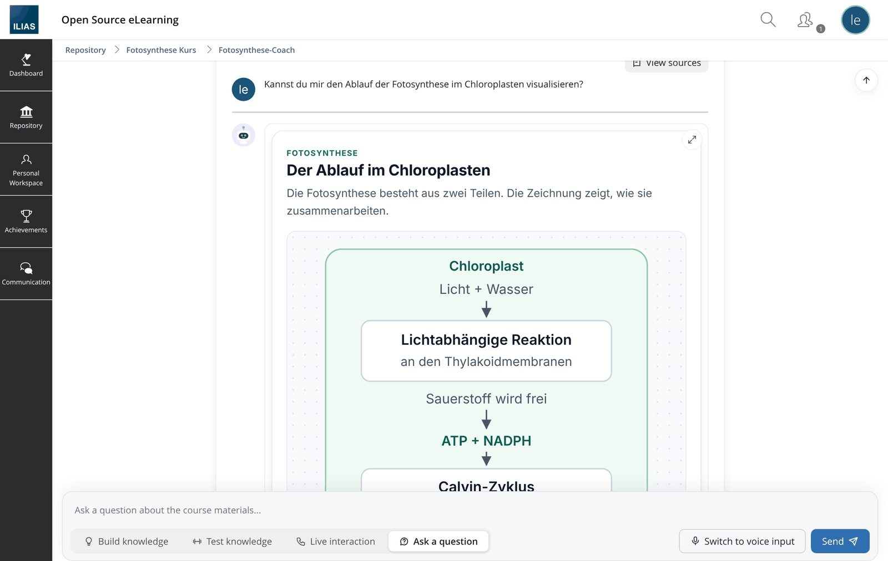
</p>

### For learners

| Ask a question | View sources |
|:--:|:--:|
| 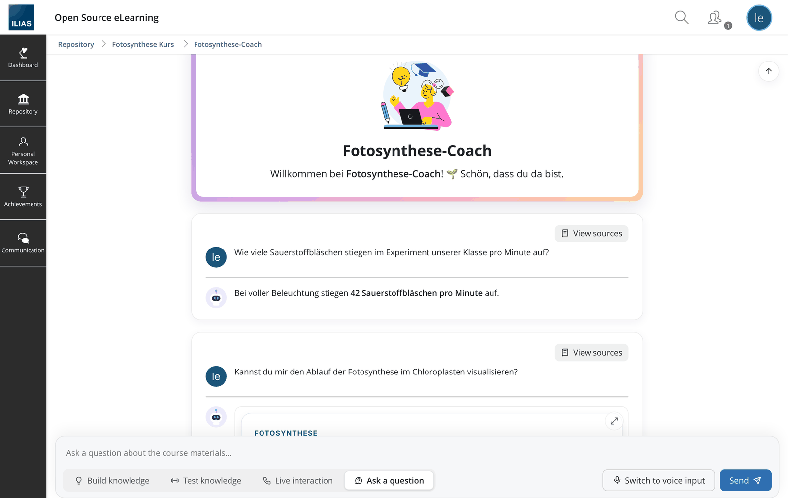 | 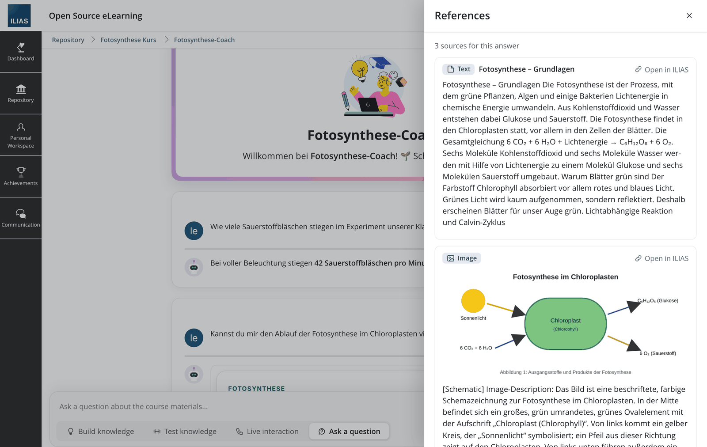 |
| Typed or spoken questions, answered from the included material. *View sources* sits at the top right of every answer Tarsus based on the material. | The passages, tables and pictures Tarsus used, in a panel that slides in from the right – each with *Open in ILIAS*. |

| Build knowledge |
|:--:|
| 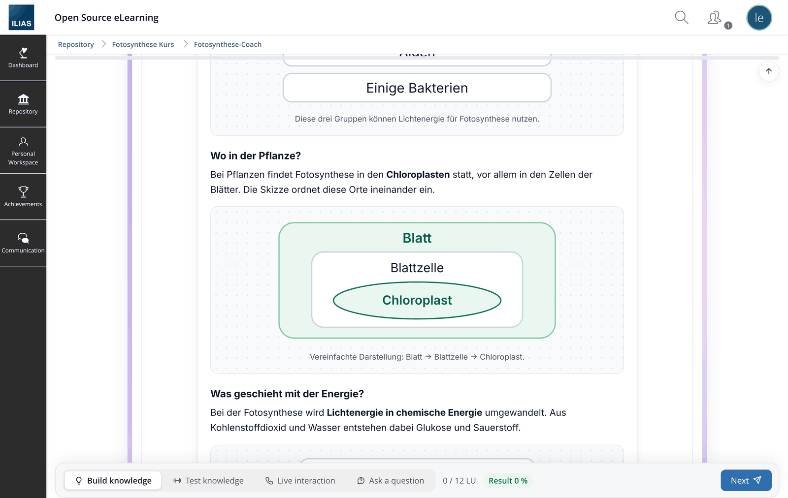 |
| Learning objectives, then stacks of slides with pictures and diagrams where Tarsus puts them, narration on request and check questions. *Ask about this* at the top right of a stack or quiz question sends the next question about exactly that. |

- The modes in the order Tarsus uses: **Build knowledge**, **Test knowledge**, **Live interaction**, **Ask a question**. Widgets form a centred column like in Tarsus.
- **Spoken questions:** record, listen back, send – the answer shows the recording and the text Tarsus heard.
- **Live interaction:** a voice call with the AI trainer; the page of the call may use the microphone.
- **English and German**, following the user's interface language. A **help button** opens the support links and videos the administrator configured.

### For teachers

The buttons above the coach open panels that slide in from the right, as in Tarsus:

| Settings | Evaluation | History |
|:--:|:--:|:--:|
| 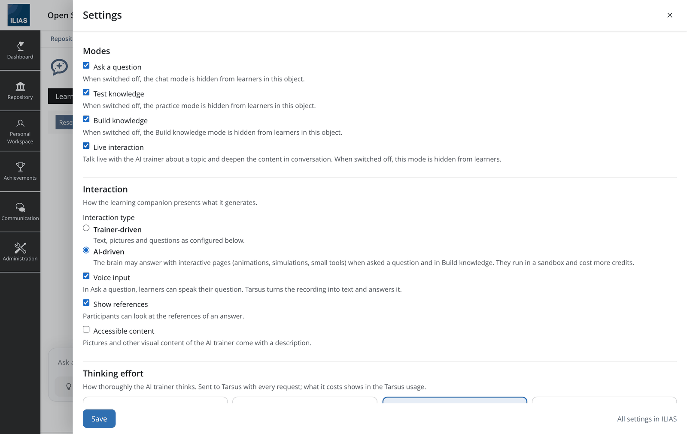 | 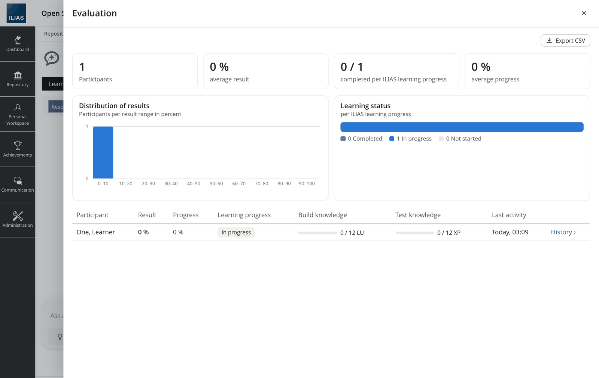 | 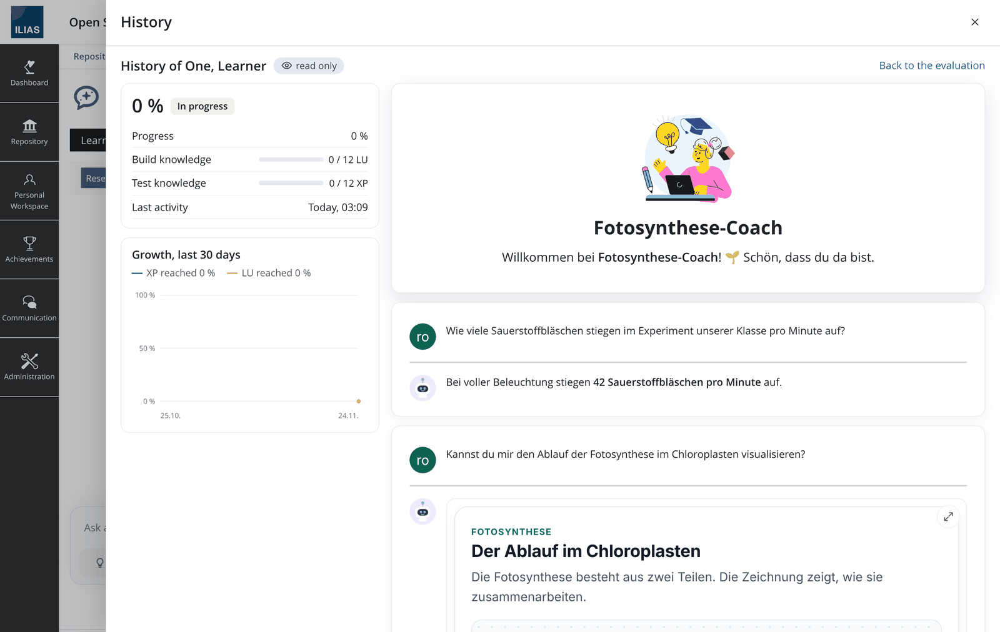 |
| Modes, interaction type, thinking level, didactics (conversation style, DQR level, target group, taxonomy levels, question types, learning pace), sources, spoken questions, visual accessibility and the completion threshold. Options outside the customer's package are shown locked. | Every learner's result, progress and learning status, the distribution of results, a filter by group and a CSV export. | One learner's conversation, read only, and how their experience points and learning units grew over the last 30 days. |

| Materials |
|:--:|
| 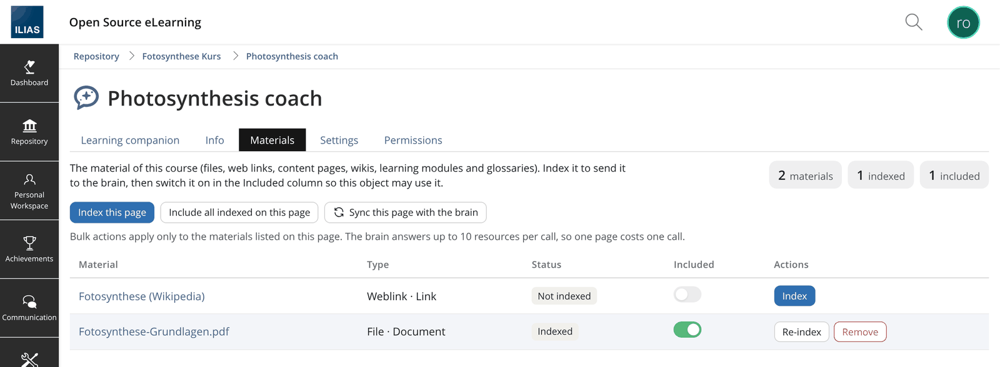 |
| Index files, web links, content pages, wikis, ILIAS learning modules and glossaries into the brain and decide per object which of them the coach may use. Edited material is sent again by itself (see [Installation, step 6](#step-6--make-sure-the-cron-job-runs)). |

### For administrators

| Plan & credits | Status |
|:--:|:--:|
| 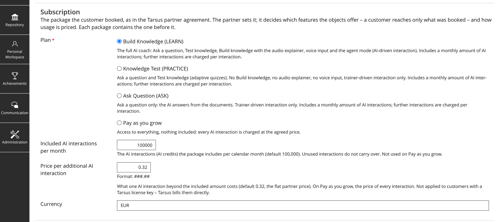 | 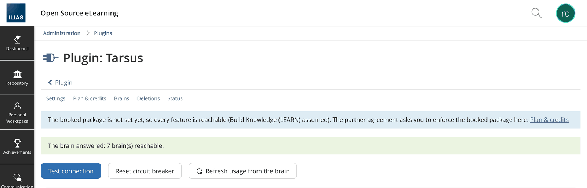 |
| The customer's package, the included AI credits and the price beyond them, the monthly credit limit and the recipients of the warnings. | Connection test, guardrails, and the month's AI credits exactly as the brain reports them. |

- **Monthly credit limit** with banners at 50 %, 75 %, 90 % and 100 % and one e-mail per threshold and month.
- **Guardrails** on every outbound call: kill switch, circuit breaker, monthly limit and rate limit.
- **Demo mode** answers with built-in samples, so every screen can be tried before an API key exists.

## Watch

Explainers from the [Tarsus YouTube channel](https://www.youtube.com/@tarsus-ai/videos) (German):

<table>
  <tr>
    <td align="center" width="33%">
      <a href="https://www.youtube.com/watch?v=JuZLVYBUBLA"></a><br>
      <b>How the Tarsus architecture works</b><br><sub>What happens between a learner's question and the coach's answer</sub>
    </td>
    <td align="center" width="33%">
      <a href="https://www.youtube.com/watch?v=kXTSVUBS9GQ"></a><br>
      <b>E-learning vs. rapid learning</b><br><sub>Why generating the course in the dialogue beats producing it up front</sub>
    </td>
    <td align="center" width="33%">
      <a href="https://www.youtube.com/watch?v=NSif7VgL_w4"></a><br>
      <b>Tarsus in practice</b><br><sub>The AI learning coach at BZEcom, with Daniel Hobein</sub>
    </td>
  </tr>
</table>

The ideas behind the coach, explained in short articles with videos:

- **[Item response theory with AI](https://tarsus.ai/praxiswissen/item-response-theory)** – why the coach weighs ability and task difficulty instead of counting right answers, and how that picks the next task.
- **[Taxonomies in e-learning](https://tarsus.ai/praxiswissen/dihk-taxonomie-stufen)** – thinking levels and knowledge types after Anderson & Krathwohl, and the "knowledge cube" the coach uses to see strengths, gaps and learning paths.
- **[The learning rate](https://tarsus.ai/praxiswissen/lernrate-adaptives-lernen)** – how adaptive learning updates a learner's level after each answer, and why surprising answers count more.
- **[DQR levels](https://tarsus.ai/praxiswissen/dqr-niveaus)** · **[Avoiding AI hallucinations](https://tarsus.ai/praxiswissen/ki-halluzinationen)** · **[Exam simulations](https://tarsus.ai/praxiswissen/pruefungssimulation-erstellen)** · all articles: [Praxiswissen](https://tarsus.ai/praxiswissen)

## Getting access

The plugin needs a Tarsus brain: the address of the Tarsus server (the *base URL*), an **API key** and a **brain ID** – or, for existing Tarsus customers, a **license key** in place of the brain ID. Tarsus sends these to your organisation; they are not in this repository and not in any release. Tarsus activates keys and brains by hand; there are no private test brains, only a sandbox brain shared by all partners on which every request is billed like any other.

- **Request access:** write to [info@tarsus.ai](mailto:info@tarsus.ai?subject=Tarsus%20for%20ILIAS) or [book an introductory call](https://outlook.office.com/book/Erstgespraech@tarsus.ai/). More about the product on [tarsus.ai](https://tarsus.ai).
- **Try the coach first:** a free account on [zero.tarsus.ai](https://zero.tarsus.ai/) lets you upload your own documents and talk to the coach before anything is installed.
- **On-premise:** Tarsus can also deploy the entire Tarsus stack on your own infrastructure if your organisation requires it. [Talk to us](mailto:info@tarsus.ai?subject=Tarsus%20on-premise).
- **Packages:** Ask Question, Knowledge Test, Build Knowledge or Pay as you grow – see [Packages, AI credits and the monthly limit](#packages-ai-credits-and-the-monthly-limit).

Until a brain is configured the plugin runs in **demo mode** with simulated answers, so administrators and teachers can explore every screen.

## Requirements

- ILIAS **9**, **10** or **11**, with the PHP version your ILIAS release requires and the `curl` extension ILIAS needs anyway. Version 2.0.0 was tested end to end on ILIAS 10.13 against a live Tarsus brain; earlier versions on 9.24, 10.12 and 11.5.
- Your ILIAS must be able to open HTTPS connections to the Tarsus server (ILIAS' own proxy settings are used).
- ILIAS must be reached over **https://** for spoken questions and the live interaction: browsers allow the microphone only on secure pages.
- ILIAS' cron job (see [step 6](#step-6--make-sure-the-cron-job-runs)).

## Installation

This guide assumes no prior knowledge. Follow the steps in order; each one says exactly what to click or type. It takes about 20 minutes.

**Before you start, you need:**

1. **An ILIAS administrator account.** You can log in to ILIAS and you see *Administration* in the menu on the left.
2. **Your ILIAS version.** It is at the very bottom of every ILIAS page, e.g. *powered by ILIAS (v10.13 …)* means ILIAS 10.
3. **A login to the server ILIAS runs on** (a "terminal" or "SSH" login). Don't have one? Ask the person or company that runs your ILIAS to do steps 2 and 3 for you – send them this page. Everything after that happens in your web browser.
4. **The e-mail from Tarsus** with the base URL, the API key and the brain ID. Don't have it yet? You can still install now – the plugin then runs in demo mode – and enter the values later ([Getting access](#getting-access)).

The plugin's buttons and the ILIAS menus are named below in English, with the German name in brackets.

### Step 1 – Download the plugin

1. Open the [latest release](https://github.com/tarsus-ai/ilias-ai-trainer/releases/latest).
2. Under **Assets**, click **Tarsus-ilias-plugin-2.0.0.zip** (the number may be higher). Your browser saves the file.

You only need this file if your server cannot download it itself – step 2 normally does that for you.

### Step 2 – Put the plugin on the server

Open the terminal of your server. Copy one box at a time, paste it into the terminal and press **Enter**. If you are asked for a password, type the password of your server login (you will not see it while typing) and press **Enter**.

**a) Go to the ILIAS folder.** On most servers it is `/var/www/ilias`:

```bash
cd /var/www/ilias
```

Not sure where ILIAS is? This prints a line ending in `/ilias.ini.php`; your ILIAS folder is that line without `/ilias.ini.php`. Use it instead of `/var/www/ilias` everywhere below.

```bash
sudo find / -name ilias.ini.php -not -path "/proc/*" 2>/dev/null
```

**b) Go to the plugin folder** (it is created if it does not exist yet).

ILIAS 10 or 11:

```bash
sudo mkdir -p public/Customizing/global/plugins/Services/Repository/RepositoryObject && cd public/Customizing/global/plugins/Services/Repository/RepositoryObject
```

ILIAS 9:

```bash
sudo mkdir -p Customizing/global/plugins/Services/Repository/RepositoryObject && cd Customizing/global/plugins/Services/Repository/RepositoryObject
```

**c) Download and unpack the plugin:**

```bash
sudo wget https://github.com/tarsus-ai/ilias-ai-trainer/releases/download/v2.0.0/Tarsus-ilias-plugin-2.0.0.zip
```

```bash
sudo unzip Tarsus-ilias-plugin-2.0.0.zip && sudo rm Tarsus-ilias-plugin-2.0.0.zip
```

This creates a folder called `Tarsus`. If the terminal says `unzip: command not found`, run `sudo apt install unzip` and try again. If your server cannot download from the internet, copy the zip from step 1 into this folder with a file transfer program (for example [FileZilla](https://filezilla-project.org/) or [WinSCP](https://winscp.net/)) and run only the `unzip` box.

**d) Hand the folder to the web server:**

```bash
sudo chown -R www-data:www-data Tarsus
```

On Red Hat, CentOS, Rocky or Alma Linux the web server user is called `apache` instead: `sudo chown -R apache:apache Tarsus`.

### Step 3 – Let ILIAS find the plugin

```bash
cd /var/www/ilias && sudo -u www-data composer du
```

Wait until it ends with *Generated optimized autoload files* (about a minute). If it says *Permission denied*, run `sudo composer du` instead and type `yes` when it asks whether to continue as root.

### Step 4 – Install and activate

1. Log in to ILIAS as administrator.
2. Open **Administration › Extending ILIAS › Plugins** (*Administration › ILIAS erweitern › Plugins*).
3. Find the row **Tarsus**, click the small arrow button at its right end and choose **Install** (*Installieren*).

   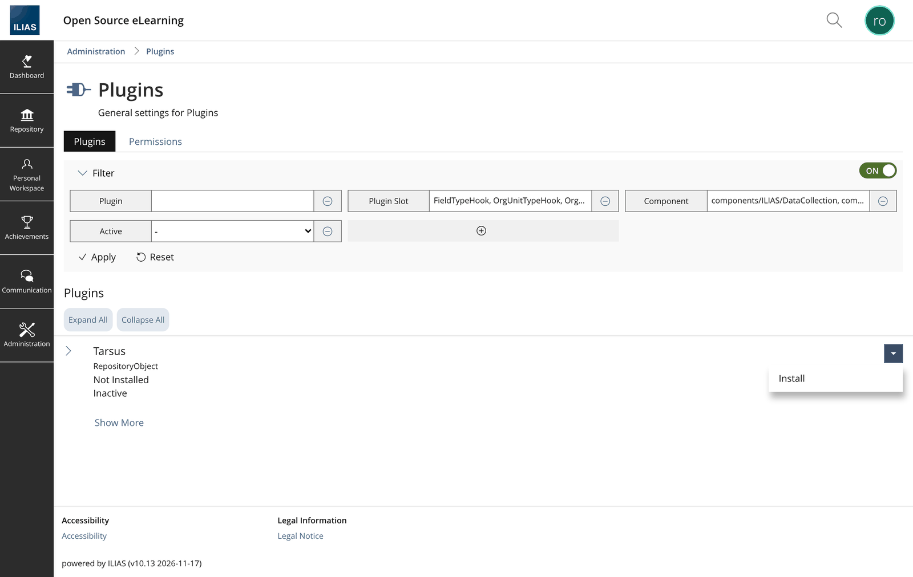

4. Click the arrow button again and choose **Activate** (*Aktivieren*).

   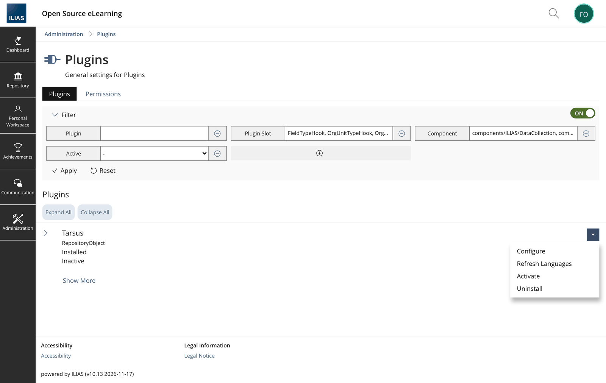

### Step 5 – Connect to Tarsus

1. Click the arrow button once more and choose **Configure** (*Konfigurieren*).
2. Copy from the Tarsus e-mail into the form – exactly, without spaces at the start or end:
   - **Base URL** (*Basis-URL*): the address of the Tarsus server.
   - **API key** (*API-Schlüssel*).
   - **Brain ID** (*Brain-ID*). Existing Tarsus customers who got a **License key** enter it in that field instead and leave the brain ID empty.

   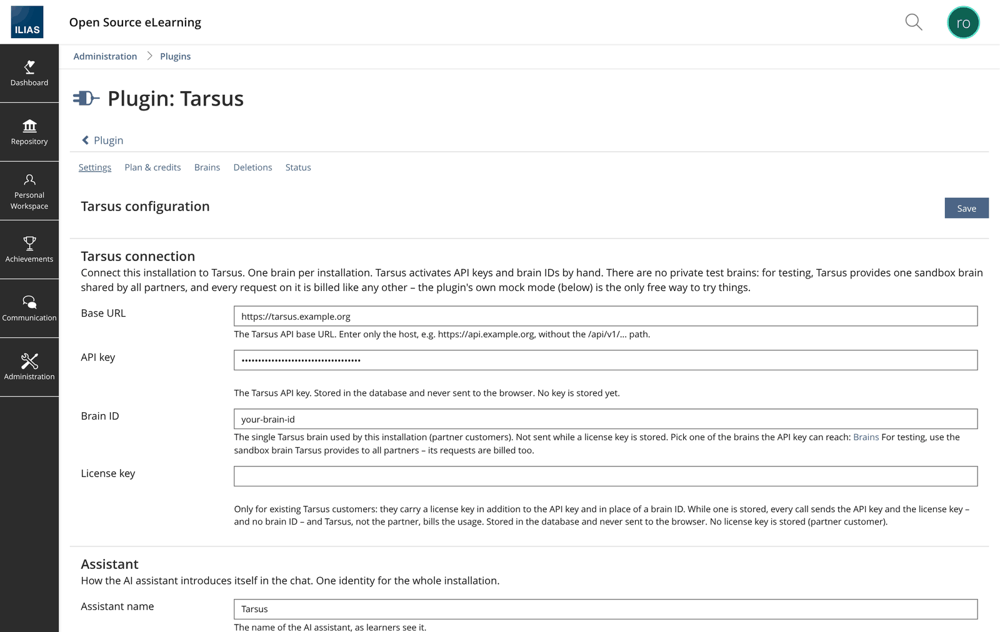

3. Scroll down and **untick** **Mock mode (demo)** (*Mock-Modus (Demo)*). Only while it is ticked does the plugin answer with samples instead of Tarsus.
4. Click **Save** (*Speichern*) at the top right.
5. Click the tab **Plan & credits** (*Plan & Credits*), choose the package from your contract, check the figures and click **Save** (*Speichern*).

   

6. Click the tab **Status** and then **Test connection** (*Verbindung testen*). A green message *The brain answered …* means everything works. A red message? See [If something does not work](#if-something-does-not-work).

   

### Step 6 – Make sure the cron job runs

The plugin has a background job that runs every 15 minutes. It removes material from the brain that was deleted in ILIAS, sends material again that was changed (for example a new version of a file, a page that was edited, a web link with a new address), confirms new material and fetches the month's AI credits. It switches itself on.

1. Open **Administration › System Settings and Maintenance › General Settings** (*Administration › Systemeinstellungen und Wartung › Allgemeine Einstellungen*) and click the tab **Cron Jobs** (*Cron-Jobs*).
2. Find **Tarsus: synchronise the brain**. It should say *Every 15 minutes* and *Active*.

   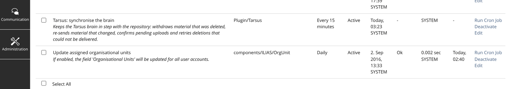

ILIAS only runs its cron jobs when the server starts them. Most servers already do this for ILIAS. To check, look at the Tarsus row again after half an hour: the date in the column for the last run should be recent. If it stays empty, run this once in the terminal (ILIAS 10 or 11). Replace `root` with the login of an ILIAS administrator and `default` with your client ID – the name of the folder in `/var/www/ilias/public/data`:

```bash
echo '*/15 * * * * www-data /usr/bin/php /var/www/ilias/cli/cron.php run-jobs root default' | sudo tee /etc/cron.d/ilias
```

ILIAS 9: use `cron/cron.php` instead of `cli/cron.php`; the client ID is the name of the folder in `/var/www/ilias/data`.

### Step 7 – Add the coach to a course

1. Open a course or group and click **Add New Object** (*Neues Objekt hinzufügen*; ILIAS 9: *Add New Item*). Click **Other** (*Weitere*) and then **Tarsus**.

   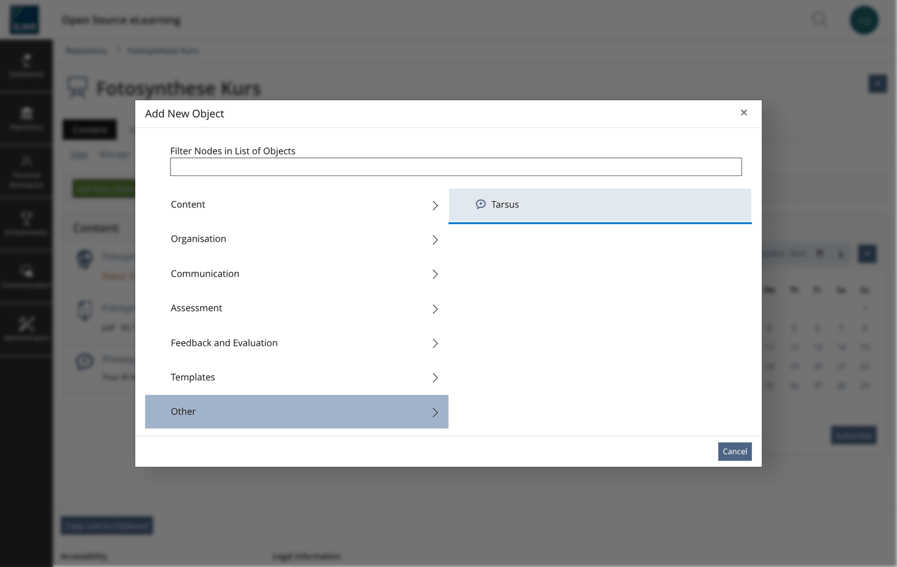

2. Type a title, for example *Learning coach*, and click **Add Tarsus** (*Tarsus hinzufügen*).

   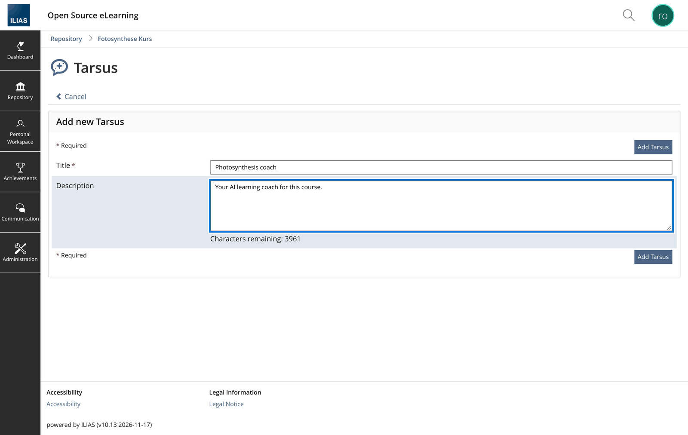

3. On the tab **Settings** (*Einstellungen*), tick **Online** and click **Save** (*Speichern*). New objects are offline until you do this.

   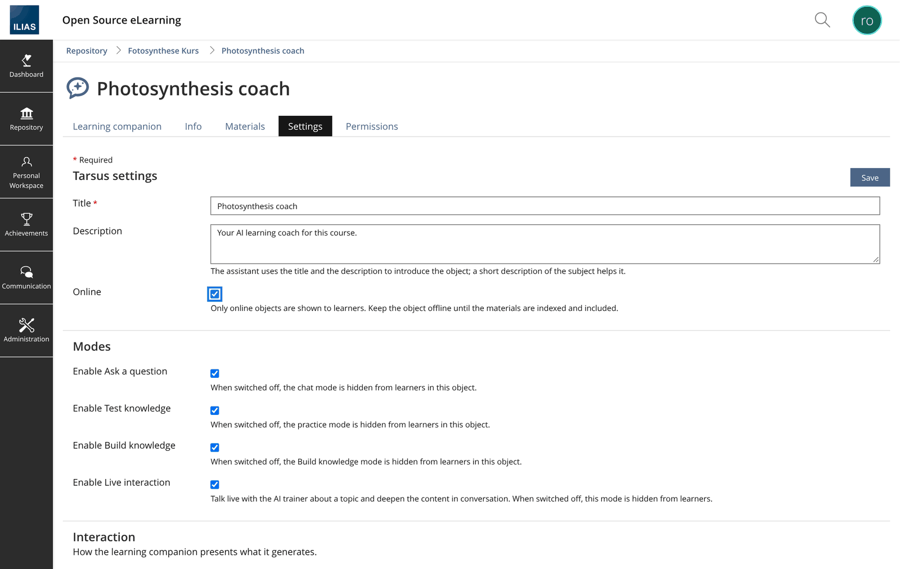

4. Click the tab **Materials** (*Materialien*). It lists the files, web links, content pages, wikis, learning modules and glossaries of the course. Click **Index** (*Indexieren*) next to each one the coach should use. Tarsus reads it, which takes a few minutes; click **Sync this page with the brain** (*Diese Seite mit dem Brain abgleichen*) to see the status change to **Indexed** (*Indexiert*). Then click **Include all indexed on this page** (*Alle Indexierten dieser Seite einbeziehen*).

   

**Done.** Learners now find the coach in the course. Open it yourself to see what they see; the buttons **Settings**, **Evaluation** and **History** above the coach are only shown to teachers.

## Updating

1. In the terminal, go to the plugin folder from [step 2 b](#step-2--put-the-plugin-on-the-server) and move the old version out of the way (not into another folder inside ILIAS):

   ```bash
   sudo mv Tarsus /tmp/Tarsus-old
   ```

2. Download and unpack the new version and hand it to the web server: step 2 c and 2 d, with the new version number.
3. Step 3: `composer du`.
4. In **Administration › Extending ILIAS › Plugins** click the arrow button of **Tarsus**, choose **Update** (*Aktualisieren*), then **Refresh Languages** (*Sprachen neu laden*).

Database updates run during the update; settings, material indexes and learner figures are kept. The [changelog](CHANGELOG.md) lists what changed in each version.

## If something does not work

| What you see | What to do |
|---|---|
| Tarsus is not in the plugin list | Check that the folder is called exactly `Tarsus` and is in the plugin folder of step 2 b, then repeat step 3. |
| *Test connection* says the API key or brain is not accepted | Copy the API key and brain ID again from the e-mail, without spaces, and save. If it persists, ask Tarsus whether the key is activated. |
| *Test connection* says Tarsus cannot be reached | Your server may not reach the internet. Ask your IT to allow HTTPS connections from the ILIAS server to the Tarsus address; if ILIAS uses a proxy, enter it in ILIAS' proxy settings. |
| Learners read *The course materials are still being prepared* | Nothing is indexed and included yet, or Tarsus is still reading it. Check the *Materials* tab (step 7.4) and wait a few minutes. |
| The microphone button is missing or does nothing | Use ILIAS over `https://`, and allow the microphone when the browser asks. Spoken questions and the live interaction can also be switched off in the teacher's *Settings*. |
| The coach still uses an old version of a file or page | The cron job sends changed material again within 15 minutes (step 6). To do it at once, click **Re-index** (*Neu indexieren*) on the *Materials* tab. A web link is read once: if only the page behind the same address changes, click **Re-index**. |
| A red message about the monthly limit | The month's AI credits reached the limit set on *Plan & credits*. Raise the limit there, or wait for the next month. |

The plugin writes the details of every failed call to the ILIAS log (never the API key).

## Configuration

*Administration › Extending ILIAS › Plugins › Tarsus › Configure* has five tabs:

| Tab | What it holds |
|---|---|
| **Settings** | Connection to the brain (base URL, API key, brain ID, and the license key of an existing Tarsus customer), demo mode, the coach's name and avatar, voice, guardrails (kill switch, rate limit), and the help links shown behind the help button – one `Title \| URL` per line. |
| **Plan & credits** | The booked package, the included AI credits and the price beyond them, the monthly limit and the recipients of the warnings (see below), plus the features per package of the partner agreement. |
| **Brains** | The brains the API key can reach; activate the one this installation should use. |
| **Deletions** | Material withdrawals the brain has not confirmed yet. |
| **Status** | Connection test, customer type (partner customer or Tarsus license key), booked package, guardrail state, the month's AI credits as the brain reports them (with a refresh button and the breakdown by service) and the cost beyond the included amount. |

Changing the connection – leaving demo mode, another server, another brain ID or license key – sends the material the previous brain held to the new one by itself; the configuration page says how many.

## Packages, AI credits and the monthly limit

The package the customer booked is recorded on the *Plan & credits* tab. The plugin implements the rules of the [Tarsus partner agreement](https://tarsus.ai/impressum/partnervereinbarung): a customer reaches only the features of the booked package, and existing Tarsus customers are recognised by their license key. The figures are editable for custom agreements.

**Features per package** – each package contains the one before it:

| Feature | Ask Question | Knowledge Test | Build Knowledge | Pay as you grow |
|---|:--:|:--:|:--:|:--:|
| Ask a question: the AI answers from the documents | ✓ | ✓ | ✓ | ✓ |
| Test knowledge: the AI creates and marks quizzes | – | ✓ | ✓ | ✓ |
| Build knowledge: the coach explains step by step | – | – | ✓ | ✓ |
| Audio explainer in the coach | – | – | ✓ | ✓ |
| Spoken questions (voice input) | – | – | ✓ | ✓ |
| Agent mode (AI-driven interaction type) | – | – | ✓ | ✓ |
| Live interaction | – | – | ✓ | ✓ |

The package is enforced everywhere: features outside it are locked in the object settings, hidden from the learner's mode switch and refused by the server. While no package is set on a live connection, the configuration pages say so – until then Build Knowledge is assumed.

**AI credits come from the brain only.** Tarsus counts the AI credits of every request itself (fractions included – a step can cost 1.57 credits) and reports them per brain. The plugin fetches this figure – at most once a minute while people use the coach, from the cron job, and with *Refresh usage from the brain* on the *Status* tab – and uses it for the monthly limit, the warnings and the cost. It does not count or estimate credits itself. What each kind of request costs is decided by Tarsus; the public overview is at [tarsus.ai/ki-interaktionen](https://tarsus.ai/ki-interaktionen). A higher **thinking level** (1–4, set per object, 4 by default) gives more thorough answers and costs more credits.

- The subscription packages include 100,000 AI credits per **calendar month** (editable); Pay as you grow includes none. Included credits do not carry over. Credits beyond them are charged at the agreed price (0.32 EUR flat for partner customers unless agreed otherwise).
- **License key:** an existing Tarsus customer enters the license key next to the API key. Every call then carries the API key and the license key – and no brain ID, the two forms never mix – and the status pages show that Tarsus bills this customer directly; no partner price is applied.
- The **monthly limit** is the most AI credits the installation may spend per calendar month. It defaults to the included amount; `0` means no limit. Once it is reached, AI requests are refused with a clear message for learners and a banner for teachers and administrators. At 50 %, 75 %, 90 % and 100 % a banner appears and one e-mail per threshold and month goes to the configured recipients (or the installation's administrator address). Raising the limit takes effect at once; lowering it shows what has already been used and asks for confirmation.

## Interaction types

Each object has an interaction type, sent to the brain as `interaction_type` with every generate call:

- **trainer-driven** – the coach answers with text, formulas, tables, pictures and the usual question widgets.
- **ai-driven** – the coach may additionally answer with HTML pages: animations, simulations, small tools (a rotating cylinder whose volume follows the sliders, a capacitor discharge curve with a marker, a diagram of a process, …), both in *Ask a question* and in *Build knowledge*.

Pages are rendered in an `<iframe sandbox="allow-scripts allow-forms allow-pointer-lock">` with `srcdoc`, so they can run their scripts but cannot reach ILIAS, its cookies or the surrounding page. They size themselves to their content; an *Enlarge* button opens a page in a dialog. The page of the **live interaction** is the one exception: it runs in a frame without the sandbox that may use the microphone (`allow="microphone; autoplay"`), because the call needs it. AI-driven interaction and the live interaction are available on the Build Knowledge and Pay as you grow packages.

## Result and progress

Tarsus reports experience points (XP), learning units and the progress of every learner. The plugin shows XP and learning units as they are, and turns them into a **result in percent** for ILIAS – the figure in ILIAS' learning progress, the *Evaluation* panel and the CSV export. Which figures count depends on the modes active in an object (a mode is active when it is enabled in the settings and allowed by the package):

| Active modes | Result (ILIAS learning progress, %) | Progress (for *completed*) |
|---|---|---|
| Test knowledge only | XP earned in percent of all XP | the brain's practice progress |
| Build knowledge only | learning units completed in percent | the brain's learning progress |
| Test and Build knowledge | XP earned in percent of all XP | learning units completed in percent |
| Neither (Ask a question or Live interaction only) | – | – (read-only activity) |

A learner counts as completed once the progress reaches the object's completion threshold. A result that falls back to 0 – after *Reset chat history*, or a connection to another brain – is written to ILIAS as well. Figures are recomputed when the package or the modes change.

## Data and privacy

- The plugin talks to the brain over HTTPS only; every call carries the installation's API key and brain ID – or, for an existing Tarsus customer, the API key and the license key – and passes the guardrail pipeline (kill switch → circuit breaker, which opens after five consecutive outages for five minutes → monthly credit limit → rate limit). Refusals from Tarsus are shown with their own clear message and do not trip the breaker; nothing is retried blindly.
- The plugin keeps its data in seven tables (`rep_robj_xtar_*`): plugin configuration (including the plan, the limit and the brain's usage figure), the settings of each object, the index map of the material sent to the brain, the inclusions per object, the latest figures per learner, a log of the requests sent, and the guardrail state. Uninstalling the plugin drops them.
- Learners are sent to the brain under a **pseudonym** – an HMAC of the ILIAS user id with a secret generated at installation – together with their display name and interface language. The conversation itself lives in the brain. *Reset chat history* erases the learner's own conversation in the brain and the local figures. A spoken question is sent to Tarsus as audio to be transcribed.
- Interactive pages from the brain run sandboxed (see above) and are never stored in ILIAS beyond the conversation history the brain returns.
- The coach does not search the internet: it generates explanations and answers exclusively from the documents your organisation provides. Tarsus stores your content at Microsoft Azure in Germany, GDPR-compliant – and the entire stack can be deployed on-premise on request ([Getting access](#getting-access)).

## Development

```
plugin.php                 plugin id, version and ILIAS range
classes/                   ILIAS entry points (plugin, object, GUI, access, list GUI, config GUI)
src/                       namespace TarsusIlias
  Activity/                settings, didactics, conversation state, scoring
  Client/                  HTTP client, demo (mock) client, client factory
  Cron/                    the synchronisation job
  Guardrail/               kill switch, breaker, budget, rate limit
  Index/, Material/        material discovery and indexing state machine
  Output/                  views, shaper of brain responses, media checks, icons
  Service/                 learner, teacher and settings endpoints (AJAX), messages
  Support/                 configuration, package (Plan), budget, help links, ILIAS glue
sql/dbupdate.php           database steps
templates/                 CSS, JavaScript, images and the demo mode's pages
lang/                      ilias_en.lang, ilias_de.lang
tests/                     PHPUnit tests (not in the release zip)
docs/screenshots/          the screenshots in this README
```

- **Demo mode** (default after installation) makes the whole interface usable without a brain: the demo client answers with fixed samples for every call, including interactive pages, a demo live page and sources. All demo brain names start with `mock-`.
- **Unit tests** cover the package rules, the pricing of the month and the credentials every call carries (API key with brain ID, or with license key). They need the interfaces of an ILIAS checkout (PHPUnit 10 or 11 ships with ILIAS 10 and 11): `ILIAS_ROOT=/path/to/ilias php /path/to/ilias/vendor/composer/vendor/bin/phpunit -c phpunit.xml`.
- Version 2.0.0 was tested end to end with Playwright in ILIAS 10.13 against a live Tarsus brain: clean install from the release zip, all four modes, spoken questions, sources, AI-driven pages, the live call, the teacher panels, re-sending edited material, reset, the learning progress and the usage figures.
- A version bump needs `composer du` before ILIAS offers **Update** in the plugin list.
- **Releases** are published by the [Release workflow](.github/workflows/release.yml): bump `$version` in `plugin.php`, add the version's section to `CHANGELOG.md` and push to `main` – the workflow tags the commit, builds `Tarsus-ilias-plugin-<version>.zip` with `git archive` (repository-only files such as `docs/` are left out) and creates the GitHub release with the changelog section as notes.

Issues and pull requests are welcome.

## Acknowledgements

Our thanks go to **Fred Neumann**, **Martin Studer** and **Lars Egger** for all the years of support in the ILIAS world – this plugin stands on what they built and shared.

## Licence

GPL-3.0-or-later – see [LICENSE](LICENSE). © 2026 Tarsus GmbH, [tarsus.ai](https://tarsus.ai).

<p align="center"><sub>Our goal is to make high-quality education as accessible as Netflix.</sub></p>
